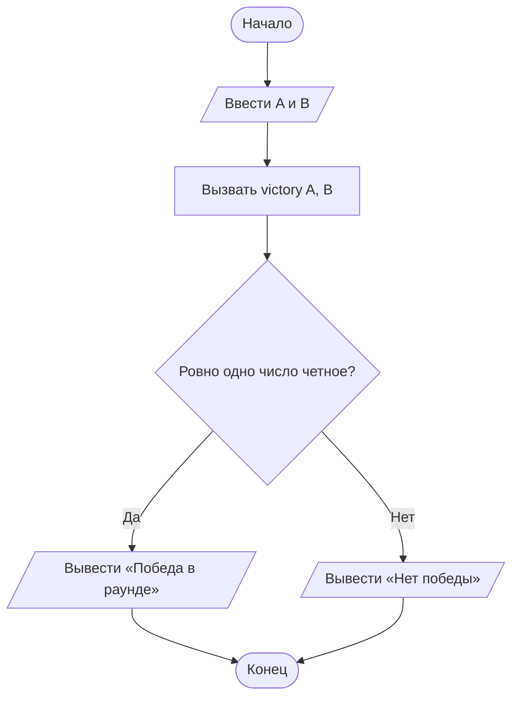

# Домашнее задание к лабораторной работе № 4

## 1. Условие задачи

**Вариант 15. Викторина**

На телевикторине два игрока (A и B) нажали на кнопки. Для победы в раунде нужно, чтобы ровно один из них нажал на кнопку с четным номером. Записать условие победы в раунде.

## 2. Алгоритм и блок-схема

1. Ввести номера кнопок A и B в функции `main()`.
2. Передать значения в функцию `victory()`.
3. Проверить, что ровно одно из двух чисел четное.
4. Вернуть результат проверки в `main()` и вывести сообщение.



## 3. Реализация программы

Ввод значений выполняется в `main()`. Проверка условия победы вынесена в отдельную функцию `victory()`, которая возвращает результат в главную функцию.

```c
#define _CRT_SECURE_NO_DEPRECATE
#include <stdio.h>
#include <locale.h>

int victory(int a, int b);

int main()
{
    int a;
    int b;

    setlocale(LC_ALL, "RUS");

    printf("Введите номера кнопок A и B: ");
    if (scanf("%d %d", &a, &b) != 2)
    {
        printf("Ошибка ввода.\\n");
        return 1;
    }

    if (victory(a, b))
        printf("Победа в раунде\\n");
    else
        printf("Нет победы\\n");

    return 0;
}

int victory(int a, int b)
{
    return ((a % 2 == 0 && b % 2 != 0) ||
            (a % 2 != 0 && b % 2 == 0));
}
```

## 4. Результаты работы программы

**Пример 1**

Ввод:
```text
2 3
```

Вывод:
```text
Победа в раунде
```

**Пример 2**

Ввод:
```text
4 8
```

Вывод:
```text
Нет победы
```

**Пример 3**

Ввод:
```text
5 7
```

Вывод:
```text
Нет победы
```

## 5. Информация о разработчике

**Хром А. И.**, группа **бИД-261**.
