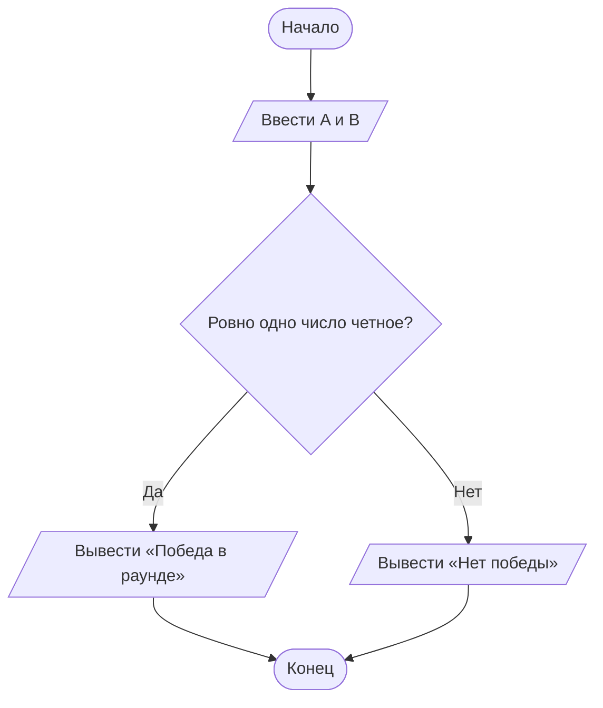

# Домашнее задание к лабораторной работе № 4

## 1. Условие задачи

**Вариант 15. Викторина**

На телевикторине два игрока (A и B) нажали на кнопки. Для победы в раунде нужно, чтобы ровно один из них нажал на кнопку с четным номером. Записать условие победы в раунде.

## 2. Алгоритм и блок-схема

1. Ввести номера кнопок A и B.
2. Проверить, что A четное, а B нечетное, или A нечетное, а B четное.
3. Если условие истинно, вывести, что раунд выигран. Иначе вывести, что победы нет.



## 3. Реализация программы

```c
#include <stdio.h>

int main() {
    int A, B;

    printf("Введите номера кнопок A и B: ");
    scanf("%d %d", &A, &B);

    if ((A % 2 == 0 && B % 2 != 0) ||
        (A % 2 != 0 && B % 2 == 0)) {
        printf("Победа в раунде\n");
    } else {
        printf("Нет победы\n");
    }

    return 0;
}
```

## 4. Результаты работы программы

**Пример 1**

Ввод:
```text
2 3
```

Вывод:
```text
Победа в раунде
```

**Пример 2**

Ввод:
```text
4 8
```

Вывод:
```text
Нет победы
```

**Пример 3**

Ввод:
```text
5 7
```

Вывод:
```text
Нет победы
```

## 5. Информация о разработчике

**Хром А. И.**, группа **бИД-261**.
